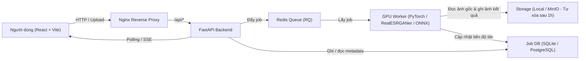

# Kế hoạch dự án: Web Upscale Ảnh dựa trên Real-ESRGAN (Degradation + KD)

Nhóm sẽ xây một web upscale ảnh giống [Upscayl](https://upscayl.org/) (kéo thả ảnh, chọn model, chọn scale, tải ảnh đã phóng to), chạy bằng model Real-ESRGAN do chính nhóm huấn luyện theo bài báo của thầy hướng dẫn, trong vòng khoảng 10 tuần.

---

## 1. Tổng quan và mục tiêu

Sản phẩm cuối gồm hai phần có liên quan chặt chẽ:

- **Model:** Real-ESRGAN được cải tiến bằng degradation nâng cao và knowledge distillation (teacher → student nhẹ), có trọng số dùng được và số liệu đánh giá rõ ràng.
- **Web app:** giao diện web gọi model đó để upscale ảnh x2/x4, có hàng đợi xử lý, xem trước so sánh trước/sau, tải ảnh về.

### Mục tiêu đo được

| Mục tiêu | Tiêu chí |
| --- | --- |
| Model student nhẹ hơn teacher mà chất lượng gần teacher | Số tham số và thời gian suy luận giảm so với `RealESRGAN_x4plus`; PSNR/SSIM/NIQE trên Set5, Set14, RealSR không kém teacher quá ngưỡng nhóm tự đặt (đề xuất ≤ 0,3 dB PSNR) |
| Model của nhóm tốt hơn Real-ESRGAN gốc trên ảnh thực | Bảng so sánh trên RealSR + bộ ảnh thực tự thu thập (NIQE, PSNR, SSIM, đánh giá mắt người) |
| Web chạy ổn định | Upscale ảnh 1080p → 4K không crash, ảnh lớn tự chia tile, có thông báo tiến độ |
| Demo được | Bản deploy có link công khai (hoặc chạy bằng Docker một lệnh) |

- **Trong phạm vi:** upscale ảnh tĩnh (PNG/JPG/WebP, có hỗ trợ kênh alpha), so sánh before/after, chọn model, tải ảnh, hàng đợi, giới hạn kích thước, batch hàng nghìn ảnh.
- **Tài nguyên phần cứng:** Cần có ít nhất 1 GPU để huấn luyện (server `/storage/student12` như trong config hiện tại) và 1 GPU hoặc CPU mạnh để demo.

---

## 2. Hiện trạng repo của bài nghiên cứu của khầy hà

Repo `RealESRGAN_Degradation_KD` đã có sẵn phần nghiên cứu (*"Towards Real-ESRGAN refinement for Realistic Image Restoration via Advanced Degradation and Knowledge Distillation"*); phần còn thiếu là đóng gói model thành dịch vụ và giao diện web. Bảng dưới đây tóm tắt những gì đã thấy trong thư mục.

| Thành phần | Vị trí trong repo | Trạng thái / ghi chú |
| --- | --- | --- |
| Sinh degradation nâng cao | `degradation/RealisticDegradationGenerator_RealESRGAN*.py`, `..._BasicVSR.py`, `degradation_tools.py` | Có 3 phiên bản generator; cần chốt phiên bản dùng cho model cuối và ghi lại tham số |
| Tiền xử lý dữ liệu | `tools/preprocess_tools/`, `tools/combinedata_tool/`, `src/extract_subimages_mini.py` | Có xử lý DIV2K+, RealSR, Unsplash; dữ liệu đang nằm ở server `/storage/student12/...` |
| Huấn luyện teacher (fine-tune x4plus) | `Real-ESRGAN/options/finetune_realesrgan_x4plus_pairdata.yml` | Đã có checkpoint `net_g_575000.pth` (theo config student) |
| Knowledge distillation teacher → student | `Real-ESRGAN/options/finetune_realesrgan_x4plus_pairdata_student.yml` | Student `RRDBNet` `num_feat=48`, `num_block=16`, `num_grow_ch=24` (teacher gốc: 64/23/32); loss gồm L1, perceptual, GAN, distillation (0,7) và feature distillation (0,5); đang resume từ 500k/600k iter |
| Model tùy biến | `src/custom_realesrgan_model.py`, `src/train.py`, `src/finetune_custom_realesrgan_x4plus_subset.yml` | Bản fine-tune nhẹ trên subset (10k iter, chạy trên Colab) — dùng để thử nhanh |
| Inference | `inference_realesrgan*.py` (gốc, custom, student, video) | CLI có tile, fp16/fp32, alpha; chưa đóng gói thành API |
| Đánh giá | `tools/evaluate_psnr_ssim_niqe.py`, `calculate_metrics*.py`, `comparision_image_*.py` | Có số liệu Set5/Set14 (`*_original_metrics.txt` vs `*_our_metrics.txt`) |
| Xuất model | `Real-ESRGAN/scripts/pytorch2onnx.py` | Có script ONNX gốc; chưa kiểm chứng cho student |
| Trọng số | Google Drive (link trong README) | Cần chốt phiên bản đưa lên một nơi cố định (Hugging Face / GitHub Release) |
| Web / API / Docker | — | Chưa có gì, toàn bộ là việc mới |

### Những vấn đề cần xử lý trước khi làm web:

- Config đang dùng đường dẫn tuyệt đối của máy (`/storage/student12/...`, `/content/...`): cần đưa về đường dẫn tương đối/biến môi trường để cả nhóm tái lập được.
- Repo chứa cả `BasicSR`, `Real-ESRGAN`, ảnh thử và nhiều script rời: nên tách thư mục web (`webapp/`) riêng, không trộn vào code nghiên cứu.
- `requirements.txt` ở gốc chỉ liệt kê thư viện BasicSR (không ghim phiên bản, thiếu `realesrgan`, `facexlib`, `gfpgan`): cần môi trường ghim phiên bản cho cả train và serve.
- Giấy phép: repo dùng Apache 2.0, nhưng các bộ dữ liệu (DIV2K, RealSR, Unsplash) và trọng số pretrained có điều khoản riêng; cần rà trước khi công khai web.
- README chưa nêu số liệu chính và cách chạy; việc viết lại README là một đầu việc trong kế hoạch.
- Chưa đọc được nội dung bài báo (chỉ thấy tên trong README), nên các mục tiêu chất lượng ở Phần 1 là đề xuất — cần đối chiếu với số liệu thực trong bài.

---

## 3. Kiến trúc hệ thống

Web gồm ba lớp: giao diện React, API FastAPI, và worker GPU chạy model. Upscale ảnh nặng (vài giây đến vài chục giây) nên API không chạy model trực tiếp mà đẩy job vào hàng đợi; worker lấy job, xử lý theo tile rồi ghi kết quả ra kho lưu trữ.

Worker là thành phần duy nhất cần GPU; có thể nhân bản worker để tăng thông lượng mà không đụng API.

| Lớp | Lựa chọn đề xuất | Lý do |
| --- | --- | --- |
| Frontend | React + Vite + TypeScript, Tailwind CSS | Nhanh, dễ chia component; có thư viện slider so sánh ảnh |
| API | FastAPI (Python) | Cùng hệ Python với PyTorch/BasicSR, tự sinh tài liệu OpenAPI để FE/BE thống nhất hợp đồng |
| Hàng đợi | Redis + RQ (hoặc Celery) | Đơn giản, đủ cho quy mô đồ án |
| Worker suy luận | PyTorch + `RealESRGANer` (tile, fp16), có thể thêm ONNX Runtime | Tái dùng code inference đã có trong repo |
| Lưu trữ | Đĩa cục bộ (hoặc MinIO/S3), xóa tự động sau 1 giờ | Bảo vệ quyền riêng tư ảnh người dùng |
| Trạng thái job | SQLite (dev) / PostgreSQL (deploy) | Lưu job, trạng thái, thời gian xử lý |
| Real-time | Polling hoặc Server-Sent Events | Báo tiến độ theo số tile đã xong |
| Triển khai | Docker Compose (`nginx`, `api`, `worker`, `redis`), CI bằng GitHub Actions | Chạy lại được bằng một lệnh |

**Luồng xử lý một ảnh:** người dùng tải ảnh lên, API kiểm tra định dạng/kích thước và tạo job, worker upscale rồi lưu kết quả, giao diện nhận trạng thái `done` và hiển thị slider trước/sau cho người dùng tải về.

### Hợp đồng API tối thiểu (chốt ở tuần 1):

- `POST /api/upscale` nhận `file`, `model`, `scale`, `format`, trả `job_id`
- `GET /api/jobs/{id}` trả `status` (`queued`, `processing`, `done`, `failed`), `progress`, thời gian xử lý
- `GET /api/jobs/{id}/result` tải ảnh kết quả
- `GET /api/models` liệt kê model và scale hỗ trợ
- `GET /api/health` cho kiểm tra deploy

**Phương án dự phòng:** nếu không có GPU để host, worker chạy CPU với student nhẹ và giới hạn ảnh đầu vào (ví dụ ≤ 1024 px cạnh dài), hoặc chạy inference ngay trên trình duyệt bằng ONNX Runtime Web (WebGPU) cho bản demo.

---

## 4. Các workstream và công việc chi tiết

Công việc chia thành 3 phần chính cho 7 người: **A (Model)** do 2 người lo; **B (Backend và hạ tầng)** và **C (Frontend, tài liệu, quản lý)** do 5 người còn lại lo, đề xuất B 2 người và C 3 người (đổi được nếu muốn). Mỗi dòng có sản phẩm rõ ràng để người khác kiểm được.

### Bảng thành viên (điền tên vào cột Tên thành viên)

| Phần | Phạm vi | Số người | Tên thành viên | Trưởng phần |
| --- | --- | --- | --- | --- |
| A | Model: dữ liệu, huấn luyện, KD, đánh giá, đóng gói | 2 | Duy, Ngoại binh | *(chưa điền)* |
| B | Backend, worker, hạ tầng, triển khai | 3 | Hoàng, Thịnh, Thiên | *(chưa điền)* |
| C | Frontend, UX, tài liệu, quản lý dự án | 3 | Ngô, Dũng, Đức | *(chưa điền)* |

### A. Model (2 người)

A gồm dữ liệu và degradation (A1–A5), huấn luyện teacher/student và KD (A6–A10), đánh giá và đóng gói model (A11–A15).

#### A1–A5: Dữ liệu và degradation

| # | Công việc | Sản phẩm |
| --- | --- | --- |
| A1 | Chốt phiên bản degradation generator dùng cho model cuối trong 3 file `RealisticDegradationGenerator_*`; viết tài liệu tham số (blur, resize, noise, JPEG, camera noise) | `degradation/README.md` + file cấu hình một nguồn duy nhất |
| A2 | Gom và làm sạch dữ liệu (DIV2K+, RealSR, Unsplash) bằng `tools/preprocess_tools`, kiểm tra ảnh lỗi, cắt sub-image | Bộ train/val/test cố định + `meta_info.txt` |
| A3 | Sinh cặp LR–HR bằng degradation; lưu seed để tái lập | Thư mục dữ liệu + script `make_dataset.sh` |
| A4 | Chuẩn hóa đường dẫn: thay `/storage/student12/...` và `/content/...` bằng biến môi trường hoặc đường dẫn tương đối | Config chạy được trên máy thành viên khác |
| A5 | Thu thập bộ ảnh thực (ảnh cũ, ảnh điện thoại nén mạnh, ảnh mờ) để so sánh chất lượng và làm ảnh demo cho web | 30–50 ảnh thực có ghi nguồn/giấy phép |

#### A6–A10: Huấn luyện model và knowledge distillation

| # | Công việc | Sản phẩm |
| --- | --- | --- |
| A6 | Dựng lại môi trường train (Python, PyTorch, BasicSR, realesrgan) ghi đủ phiên bản | `environment.yml` hoặc `requirements-train.txt` + Dockerfile train |
| A7 | Xác nhận teacher: fine-tune `RealESRGAN_x4plus` trên cặp LR–HR (`finetune_realesrgan_x4plus_pairdata.yml`), đối chiếu với checkpoint đang có | Teacher cuối + log train |
| A8 | Huấn luyện student (`RRDBNet` 48/16/24) theo `..._student.yml`: distillation 0,7 và feature distillation 0,5; chạy ablation (không KD, chỉ output KD, thêm feature KD) | Bảng ablation và student tốt nhất |
| A9 | Thử thêm model x2 (`train_realesrgan_x2plus.yml`) để web có lựa chọn x2/x4 | Trọng số x2 (nếu đủ thời gian; không thì x2 = x4 rồi resize) |
| A10 | Đặt quy ước lưu checkpoint: `model_name/phiên bản/net_g_ema.pth` + file `model_card.md` | Trọng số đưa lên Hugging Face hoặc GitHub Release |

#### A11–A15: Đánh giá và đóng gói model

| # | Công việc | Sản phẩm |
| --- | --- | --- |
| A11 | Chạy PSNR, SSIM, NIQE bằng `tools/evaluate_psnr_ssim_niqe.py` trên Set5, Set14, RealSR: teacher, student, Real-ESRGAN gốc | Bảng kết quả (CSV + biểu đồ) |
| A12 | Đo tốc độ và bộ nhớ: thời gian/ảnh, VRAM đỉnh ở 512, 1080p, 4K với các tile 0/256/512 | Bảng benchmark để chọn tile mặc định cho web |
| A13 | Đánh giá chủ quan: so sánh ẩn danh trên ảnh thực, mỗi người chấm 20 cặp | Kết quả bỏ phiếu cho báo cáo |
| A14 | Viết `serve/engine.py`: hàm `upscale(image, model, scale, tile)` bọc quanh `RealESRGANer`, xử lý ảnh xám/RGBA/16-bit, báo cáo tiến độ theo tile | Module dùng chung cho worker và CLI |
| A15 | Thử xuất ONNX (`pytorch2onnx.py`) cho student, so đầu ra với PyTorch; quyết định dùng ONNX hay PyTorch ở production | Báo cáo 1 trang + file `.onnx` nếu đạt |

### B. Backend và hạ tầng (2 người)

| # | Công việc | Sản phẩm |
| --- | --- | --- |
| B1 | Khởi tạo `webapp/backend` (FastAPI), viết hợp đồng OpenAPI cho 5 endpoint ở Phần 3 và chia sẻ cho C | `openapi.json` chốt ở tuần 1 |
| B2 | Upload an toàn: giới hạn dung lượng (ví dụ 20 MB) và kích thước (ví dụ 4096 px cạnh dài), kiểm tra magic bytes thay vì đuôi file, đổi tên file ngẫu nhiên | Middleware + test |
| B3 | Hàng đợi Redis/RQ, worker đọc job, gọi `engine.upscale`, cập nhật tiến độ | Worker chạy được, thử với ảnh 4K |
| B4 | Xử lý lỗi: hết VRAM thì tự giảm tile và thử lại; timeout job; trạng thái `failed` kèm thông báo dễ hiểu | Test OOM có chủ ý |
| B5 | Dọn dẹp: xóa ảnh sau 1 giờ (cron hoặc job định kỳ); log không ghi nội dung ảnh | Task dọn dẹp + tài liệu chính sách lưu trữ |
| B6 | Giới hạn tần suất theo IP, CORS đúng, tạo endpoint `/api/health` | Cấu hình bảo mật cơ bản |
| B7 | Test: unit cho validate, integration cho luồng upload → done, test tải 10 job liên tiếp | `pytest` xanh trên CI |
| B8 | Cấu trúc repo: `research/` (code hiện tại), `webapp/backend`, `webapp/frontend`, `deploy/`; quy ước nhánh `main`/`dev`/`feature/*`, pull request có review | Repo gọn gàng + `CONTRIBUTING.md` |
| B9 | Docker Compose gồm `nginx`, `api`, `worker` (GPU), `redis`; file `.env.example` | `docker compose up` chạy cả hệ thống |
| B10 | CI GitHub Actions: lint, test, build image | Pipeline xanh |
| B11 | Chọn nơi chạy demo (máy trường có GPU, thuê GPU theo giờ, hoặc Hugging Face Space) kèm HTTPS | Link demo công khai |

### C. Frontend, tài liệu và quản lý dự án (3 người)

| # | Công việc | Sản phẩm |
| --- | --- | --- |
| C1 | Wireframe trên Figma cho 4 màn hình: trang chủ/upload, cài đặt (model, scale, định dạng), đang xử lý, kết quả | File Figma, nhóm duyệt ở tuần 1 |
| C2 | Khung React + Vite + Tailwind, router, gọi API bằng client sinh từ OpenAPI (dùng mock trước khi B xong) | Skeleton chạy được với dữ liệu mock |
| C3 | Khu vực kéo thả ảnh, xem trước, hiển thị dung lượng và kích thước ảnh, báo lỗi khi file không hợp lệ | Component `Uploader` |
| C4 | Chọn model/scale/định dạng, hiển thị kích thước ảnh đầu ra dự kiến trước khi bấm xử lý | Component `Settings` |
| C5 | Thanh tiến độ theo trạng thái job (polling/SSE), nút hủy | Component `JobProgress` |
| C6 | Slider so sánh trước/sau có zoom và kéo, nút tải về, lịch sử phiên (lưu trong trình duyệt) | Component `CompareViewer` |
| C7 | Responsive cho điện thoại, đa ngôn ngữ Việt/Anh, giao diện sáng/tối, trang giới thiệu bài báo và bảng kết quả model | Trang "Về model" lấy số liệu từ A11 và A12 |
| C8 | Kiểm thử người dùng với 5 người ngoài nhóm, sửa các lỗi hay gặp | Danh sách lỗi đã xử lý |
| C9 | Viết lại `README.md` (mục tiêu, số liệu chính, cách chạy, cách train), rà giấy phép dữ liệu/trọng số, ghi trích dẫn Real-ESRGAN và BasicSR | README + trang giấy phép |
| C10 | Họp đứng 15 phút mỗi tuần, bảng công việc (Trello/GitHub Projects), biên bản gặp thầy mỗi 2 tuần | Bảng theo dõi và biên bản |
| C11 | Báo cáo cuối, slide và video demo 2–3 phút | Bộ nộp cuối kỳ |

---

## 5. Phân công nhóm

Ba phần chia 7 người: A có 2 người lo model, B và C có 5 người lo phần còn lại. Tên từng người điền ở bảng thành viên đầu Phần 4; bảng dưới đây gợi ý cách chia việc trong từng phần và người dự phòng chéo để không ai là điểm nghẽn duy nhất.

| Phần | Số người | Kỹ năng cần | Chia việc gợi ý trong phần | Dự phòng chéo |
| --- | --- | --- | --- | --- |
| A Model | 2 | PyTorch, BasicSR, GAN, metric SR | Người 1: A1–A5 và A11–A13 (dữ liệu, đánh giá). Người 2: A6–A10 và A14–A15 (huấn luyện, KD, đóng gói) | B (hiểu `engine.upscale`) |
| B Backend và hạ tầng | 2 | FastAPI, Redis, Docker, CI | Người 1: B1–B7 (API, worker, test). Người 2: B8–B11 (repo, Docker, CI, deploy) | C (hiểu hợp đồng API) |
| C Frontend, tài liệu | 3 | React, Tailwind, Figma, viết tài liệu | Người 1: C2–C6 (giao diện chính). Người 2: C1, C7, C8 (UX, responsive, kiểm thử). Người 3: C9–C11 (tài liệu, họp, báo cáo, video) | B (chạy được backend local) |

### Quy tắc phối hợp

- **Giao diện giữa các phần:** (1) hợp đồng API giữa B và C, (2) hàm `engine.upscale` giữa A và B, (3) quy ước tên checkpoint do A đặt và B dùng. Ba thứ này phải chốt trong tuần 1 vì các phần còn lại làm song song dựa vào chúng.
- **Code review:** mỗi pull request cần ít nhất 1 người ở phần khác duyệt.
- **Huấn luyện dùng chung tài nguyên GPU:** lập lịch dùng GPU riêng (bảng chia giờ) để train và demo không tranh nhau.
- **Ghi nhật ký thí nghiệm:** mỗi lần train ghi config, commit, số liệu vào một bảng chung (TensorBoard + file `experiments.md`).

---

## 6. Timeline và các mốc kiểm tra

Ý tưởng chủ đạo: web được nối vào model có sẵn (`RealESRGAN_x4plus` hoặc teacher hiện tại) ngay từ tuần 5, nhờ đó việc train student không chặn tiến độ web; khi student xong chỉ cần đổi trọng số.

```mermaid
flowchart LR
    subgraph W1["Tuần 1–2 (M1: 29/11/2026)"]
        A_M1["A: A1, A4, A6 + Đặc tả engine.upscale"]
        B_M1["B: B1 (openapi.json), B8 (Cấu trúc repo)"]
        C_M1["C: C1 (Figma), C2 (FE Mock Skeleton)"]
    end

    subgraph W2["Tuần 3–5 (M2: 27/12/2026)"]
        A_M2["A: A2–A3, A7 (Teacher), A14 (serve/engine.py)"]
        B_M2["B: B2–B6 (API, Redis/RQ Worker, OOM), B9 (Docker)"]
        C_M2["C: C3–C6 (Uploader, Settings, Progress, CompareViewer)"]
    end

    subgraph W3["Tuần 6–8 (M3: 10/01/2027)"]
        A_M3["A: A8–A13 (Student KD, Ablation, Metrics), A15 (ONNX)"]
        B_M3["B: B7 (Pytest + Load test), B10 (CI), B11 (Deploy)"]
        C_M3["C: C7 (Trang Về model), C8 (User test 5 người)"]
    end

    subgraph W4["Tuần 9–10 (M4: 31/01/2027)"]
        ALL_M4["Tất cả: Đóng băng code, C9 (README + License), C11 (Báo cáo, Slide, Video demo)"]
    end

    W1 --> W2 --> W3 --> W4
```

### Tiêu chí qua từng mốc

| Mốc | Hạn | Điều kiện đạt |
| --- | --- | --- |
| **M1** Chốt giao diện giữa các mảng | 29/11/2026 | `openapi.json` được B và C ký duyệt; đặc tả `engine.upscale` và quy ước tên checkpoint được viết ra; wireframe Figma được duyệt |
| **M2** Web chạy end-to-end | 27/12/2026 | Upload → upscale → so sánh → tải về chạy được bằng Docker Compose với model có sẵn; ảnh 4K không crash |
| **M3** Student cuối xong | 10/01/2027 | Student có bảng ablation, đã thử ONNX, trọng số và model card đã lên nơi lưu cố định |
| **M4** Demo và báo cáo | 31/01/2027 | Link demo công khai, README mới, báo cáo, slide, video demo; chốt đóng băng code 1 tuần trước |

---

## 7. Rủi ro và tiêu chí hoàn thành

Hai rủi ro lớn nhất là thiếu GPU để host demo và student không đạt chất lượng như mong muốn; cả hai đều có phương án dự phòng mà không làm trễ M4.

| Rủi ro | Mức độ | Cách giảm thiểu | Phụ trách |
| --- | --- | --- | --- |
| Không có GPU để host demo | Cao | Chạy student trên CPU với giới hạn ảnh nhỏ; hoặc ONNX Runtime Web; hoặc thuê GPU theo giờ chỉ trong tuần demo | B |
| Student không đạt chất lượng | Trung bình | Web dùng teacher làm mặc định, student là lựa chọn "nhanh"; báo cáo vẫn trình bày kết quả ablation trung thực | A |
| Train dài (config hiện tại 600k iter) vượt lịch | Cao | Resume từ checkpoint 500k, đặt mốc M3, dùng bản subset 10k iter để thử nhanh trước khi chạy dài | A |
| Không tái lập được do đường dẫn và môi trường lệch giữa máy | Trung bình | A4, A6, Docker train, ghi phiên bản thư viện | A |
| Ảnh lớn gây hết VRAM hoặc chạy chậm | Trung bình | Tile mặc định từ benchmark A12, giới hạn kích thước, tự giảm tile khi OOM (B4) | A + B |
| FE và BE lệch hợp đồng API | Trung bình | Chốt OpenAPI ở M1, FE dùng mock, test hợp đồng trên CI | B + C |
| Giấy phép dữ liệu/trọng số không cho phép công khai | Trung bình | Rà ở C9; nếu cấm thì chỉ công khai code và trọng số train trên dữ liệu cho phép | Trưởng nhóm |
| Ảnh người dùng bị lộ hoặc lưu lâu | Thấp | Xóa sau 1 giờ, tên file ngẫu nhiên, không log nội dung, nêu rõ chính sách trên web | B |
| Thành viên bận hoặc nghỉ | Trung bình | Mỗi phần có người dự phòng chéo, code review chéo, họp đứng hàng tuần | Trưởng nhóm |

### Tiêu chí hoàn thành (Definition of Done)

- [ ] Student đạt mục tiêu chất lượng/tốc độ ở Phần 1 hoặc nhóm giải thích được lý do và thầy đồng ý
- [ ] Bảng so sánh PSNR/SSIM/NIQE và benchmark tốc độ đã có trong báo cáo và trên trang "Về model" của web
- [ ] Trọng số và `model_card.md` nằm ở nơi lưu cố định, README có hướng dẫn tái lập train và inference
- [ ] `docker compose up` dựng đủ web trên máy sạch, theo README
- [ ] Upload → upscale → so sánh → tải về chạy ổn định với PNG, JPG, WebP, ảnh xám và ảnh có alpha; ảnh 4K xử lý được
- [ ] Test tự động xanh trên CI; đã kiểm thử với ít nhất 5 người ngoài nhóm
- [ ] Có link demo công khai, báo cáo, slide và video demo; giấy phép và trích dẫn Real-ESRGAN/BasicSR đầy đủ

### Bước đầu tiên trong tuần này

- [ ] Họp nhóm, điền tên vào bảng thành viên ở Phần 4 và điều chỉnh ngày bắt đầu
- [ ] Gửi thầy bản kế hoạch này, xác nhận mục tiêu chất lượng và quyền dùng dữ liệu/trọng số
- [ ] B và C bắt đầu `openapi.json`; A bắt đầu đặc tả `engine.upscale` và kiểm tra checkpoint teacher, student hiện có
- [ ] Tạo thư mục `webapp/` và bảng công việc, nhập các mã A1–A15, B1–B11, C1–C11 thành thẻ
